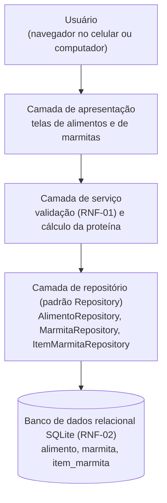

# Arquitetura do UIMarmita

Decisão completa em [ADR-001](ADRS/ADR-001-camadas.md).

## Estilo

Aplicação única (monolito) em Node.js com Express, em três camadas: apresentação, serviço e repositório, com banco de dados relacional. A dependência vai só de cima para baixo.

## Diagrama de blocos

## Responsabilidade de cada bloco

| Bloco | Faz | Não faz |
|-------|-----|---------|
| Apresentação | Mostra telas, recebe dados do usuário e chama o serviço | Regra de negócio e SQL |
| Serviço | Valida campos e números positivos (RNF-01) e calcula a proteína total da marmita | Acessar o banco direto |
| Repositório | Cadastra, lista, edita e exclui dados no banco | Validar regras do sistema |
| Banco relacional | Guarda os dados em tabelas ligadas por chave estrangeira (RNF-02) | Calcular a proteína |

## Modelo de dados

- `alimento`: id, nome, categoria, proteina_100g
- `marmita`: id, nome, dia_semana
- `item_marmita`: id, marmita_id (chave estrangeira), alimento_id (chave estrangeira), gramas

Proteína da marmita = soma de (gramas do item / 100 x proteína por 100 g do alimento).

## Padrão de projeto

**Repository:** cada tabela tem um repositório que esconde os detalhes do banco. O serviço conversa só com ele, o que facilita testar o serviço e trocar o banco depois.

## Desvantagem do estilo e mitigação

Mudanças atravessam as camadas e as regras de separação podem ser quebradas por descuido. Mitigação: regra de dependência escrita, revisão de Pull Request conferindo as camadas, testes do serviço e a mesma regra nas instruções dos agentes (E10).
