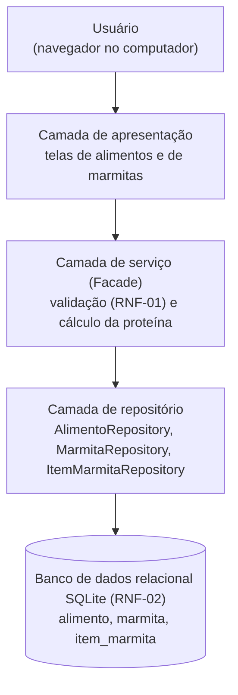

# Arquitetura do UIMarmita

Decisão completa em [ADR-001](adr/ADR-001-arquitetura-em-camadas.md).

## Estilo

Aplicação única (monolito) em Node.js com Express, em três camadas: apresentação, serviço e repositório, com banco de dados relacional. A dependência vai só de cima para baixo.

## Diagrama de blocos

## Responsabilidade de cada bloco

| Bloco | Faz | Não faz |
|-------|-----|---------|
| Apresentação | Mostra telas, recebe dados do usuário e chama o serviço | Regra de negócio e SQL |
| Serviço | Valida campos e números positivos (RNF-01) e calcula a proteína total da marmita | Acessar o banco direto |
| Repositório | Cadastra, lista, edita e exclui dados no banco | Validar regras do sistema |
| Banco relacional | Guarda os dados em tabelas ligadas por chave estrangeira (RNF-02) | Calcular a proteína |

## Modelo de dados

- `alimento`: id, nome, categoria, proteina_100g
- `marmita`: id, nome, dia_semana
- `item_marmita`: id, marmita_id (chave estrangeira), alimento_id (chave estrangeira), gramas

Proteína da marmita = soma de (gramas do item / 100 x proteína por 100 g do alimento).

## Padrão de projeto

**Facade:** cada serviço é a fachada que a apresentação usa. A tela chama um só método do serviço, e ele coordena validação, repositórios e cálculo. Detalhes no ADR-001.

## Desvantagem do estilo e mitigação

Mudanças atravessam as camadas e as regras de separação podem ser quebradas por descuido. Mitigação: regra de dependência escrita, revisão de Pull Request conferindo as camadas, testes do serviço e a mesma regra nas instruções dos agentes (E10).

## O que este diagrama mostra e o que não mostra

**Mostra:**

- Os blocos do sistema (usuário, apresentação, serviço, repositório e banco) e quem depende de quem, pela direção das setas.
- Em que camada fica cada responsabilidade: validação e cálculo no serviço, SQL só no repositório.

**Não mostra:**

- Como os dados trafegam entre os blocos (formato e conteúdo do que é enviado e recebido).
- A ordem das chamadas ao longo de uma operação.
- O tratamento de erro (o que acontece quando a validação falha ou o banco recusa um dado).
- Onde o sistema roda (máquina, servidor ou ambiente de execução).
- O desempenho de cada camada (tempo gasto em cada bloco).

Por isso o diagrama deve ser lido só como um mapa da estrutura. O exemplo abaixo ilustra um caminho possível, mas não faz parte do diagrama. O critério de desempenho está no RNF-03 e o de erro no RNF-01, ambos em specs/requisitos.md.

## Exemplo: calcular a proteína de uma marmita

Caso da marmita "Almoço segunda", com 150 g de Frango (31 g de proteína por 100 g) e 100 g de Arroz (2,5 g por 100 g):

1. Na tela, o usuário adiciona 150 g de Frango e 100 g de Arroz à marmita.
2. A camada de apresentação envia os dados ao serviço.
3. O serviço valida os campos e confere se as gramas são positivas (RNF-01).
4. O repositório grava os itens na tabela `item_marmita` do SQLite.
5. O serviço pede os itens e os alimentos ao repositório e calcula: 150 / 100 x 31 = 46,5 e 100 / 100 x 2,5 = 2,5.
6. A tela mostra a proteína total da marmita: **49,0 g**.
